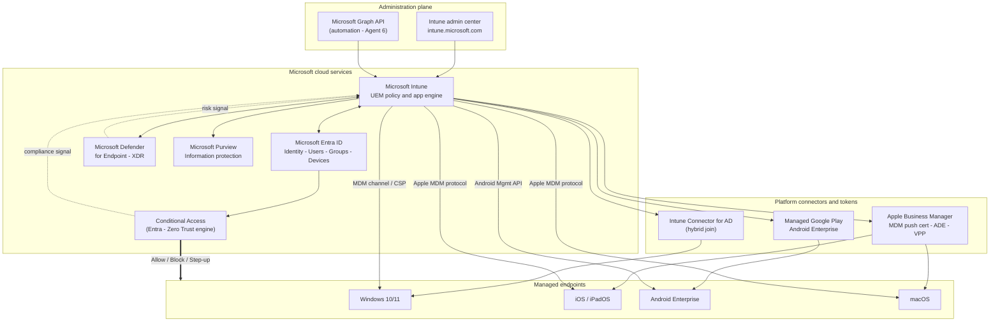
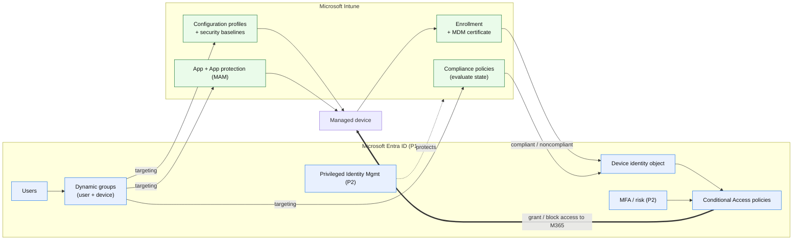
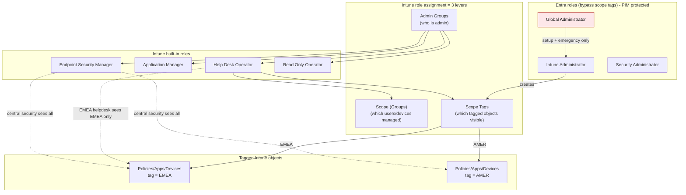
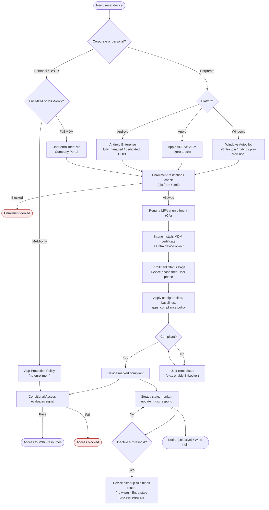

# Microsoft Intune — Architecture Diagrams

> **Ruflo Intune Engineering Lab — Agent 1: Senior Microsoft Intune Solution Architect**
> **Document:** `intune-architecture-diagrams.md`
> **Last updated:** 2026-11-21

Four Mermaid diagrams illustrating the architecture. Rendered on GitHub and any Mermaid-aware viewer. Each diagram is paired with a short legend. These are **architecture views** (design intent), cross-referenced to the verified facts in the companion documents.

**Diagram index**
1. [Microsoft Intune high-level architecture](#1-microsoft-intune-high-level-architecture)
2. [Intune and Microsoft Entra ID integration](#2-intune-and-microsoft-entra-id-integration)
3. [RBAC and scope tags architecture](#3-rbac-and-scope-tags-architecture)
4. [Device enrollment and management workflow](#4-device-enrollment-and-management-workflow)

---

## 1. Microsoft Intune high-level architecture

**Legend.** Intune is the UEM policy/app engine; **Entra ID** is the identity anchor and hosts **Conditional Access**, the Zero Trust enforcement point. Intune evaluates device **compliance** and feeds the signal to CA; **Defender for Endpoint** feeds risk signals back to Intune compliance. Platform connectors (Apple/Google/AD) are mandatory prerequisites for their platforms.
Verified basis: [Manage endpoint security in Intune](https://learn.microsoft.com/intune/device-security/endpoint-security-policies), [Zero Trust deployment with Intune](https://learn.microsoft.com/intune/fundamentals/zero-trust-deployment).

---

## 2. Intune and Microsoft Entra ID integration

**Legend.** The **enforcement loop**: Intune compliance → device object state in Entra → Conditional Access decision. Group **targeting** flows from Entra dynamic groups into Intune policy/app assignment. **MFA, risk-based CA, and PIM require Entra ID P2.**
Verified basis: [Require managed devices with Conditional Access](https://learn.microsoft.com/entra/identity/conditional-access/policy-all-users-device-compliance), [Intune planning guide — licensing](https://learn.microsoft.com/intune/fundamentals/planning-guide).

---

## 3. RBAC and scope tags architecture

**Legend.** Entra roles (red = highest privilege) ignore scope tags — minimize and PIM-protect them. Each **Intune role assignment** binds *Admin Groups* × *Scope (Groups)* × *Scope Tags*. Regional helpdesk is contained to its tag (`EMEA`); central security spans all. ⚠️ Permissions **merge** across multiple assignments — audit admins who hold more than one.
Verified basis: [Use RBAC and scope tags for distributed IT](https://learn.microsoft.com/intune/fundamentals/role-based-access-control/scope-tags), [RBAC overview](https://learn.microsoft.com/intune/fundamentals/role-based-access-control/overview).

---

## 4. Device enrollment and management workflow

**Legend.** Enrollment branches on **ownership → platform**. Restrictions are a non-security gate (✅ verified); real enforcement is **compliance + Conditional Access**. Autopilot/ADE give zero-touch corporate provisioning; BYOD prefers **MAM-only** where possible. Cleanup rules **hide** (not wipe) stale records; **retire** (selective) vs **wipe** (full) end the lifecycle.
Verified basis: [Enrollment guide](https://learn.microsoft.com/intune/device-enrollment/guide), [Enrollment restrictions](https://learn.microsoft.com/intune/device-enrollment/restrictions), [Set up the ESP](https://learn.microsoft.com/intune/device-enrollment/windows/setup-status-page), [Device cleanup rules](https://learn.microsoft.com/intune/governance/configure-cleanup-rules), [Device action: retire](https://learn.microsoft.com/intune/device-management/actions/retire).

---

## Rendering notes

- Diagrams use GitHub-compatible Mermaid. If a renderer chokes on special characters, note that labels intentionally avoid parentheses-only syntax conflicts by using ` ` and plain separators.
- These are **logical architecture views**, not literal screen flows. Implementation sequencing is owned by the respective downstream agents (2–7).

*Prepared by Agent 1 for the Ruflo orchestrator. Submitted for QA review (Agent 8).*
